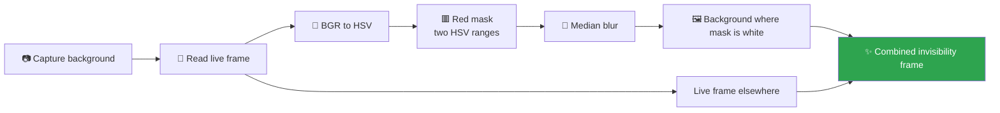

<div align="center">

# 🪄 Harry Potter Invisibility Cloak

### Make a red cloth vanish in real time with OpenCV and a webcam

*A computer-vision illusion inspired by the invisibility cloak — no magic required.*

<p>
  
  
  
</p>

</div>

---

## ✨ The effect

Hold a **red cloth** in front of the camera and the area it covers is replaced with the background — so the cloth (and whatever is behind it) appears to disappear.

The trick is a simple piece of computer vision:

1. Capture a clean background frame for a moment before you enter the scene.
2. Convert every new frame from BGR to HSV.
3. Build a mask for red pixels using two HSV ranges (red wraps around the hue circle).
4. Smooth the mask with a median blur to remove noise.
5. Replace masked (red) regions with the stored background and keep the rest of the live frame.

## 🔬 Pipeline



## 🗂️ Project structure

```text
harrypotter/
├── invisibility.py   # Camera loop and masking pipeline
└── README.md
```

## 🚀 Getting started

### 1. Clone the repository

```bash
git clone https://github.com/sanobar20/harrypotter.git
cd harrypotter
```

### 2. Install dependencies

```bash
pip install opencv-python numpy
```

### 3. Run it

```bash
python invisibility.py
```

Press **q** to quit.

## 💡 Tips for the best effect

- Use a **bright, saturated red** cloth — the HSV ranges are tuned for red.
- Keep the camera still and make sure the background is visible when the script starts.
- Good, even lighting reduces flicker and false positives.
- If the mask misses the cloth, widen the HSV ranges in `invisibility.py`.

## 🧰 Tech stack

| Tool | Role |
|:--|:--|
| Python 3 | Scripting |
| OpenCV | Camera capture, colour conversion, masking |
| NumPy | HSV range arrays and pixel operations |

## 🛣️ Ideas for later

- [ ] Add trackbars to tune the HSV ranges live.
- [ ] Support other cloak colours (green, blue).
- [ ] Add a short delay or key press to recapture the background.
- [ ] Record the output to a video file.

---

<div align="center">

**Mischief managed. 🗺️**

</div>